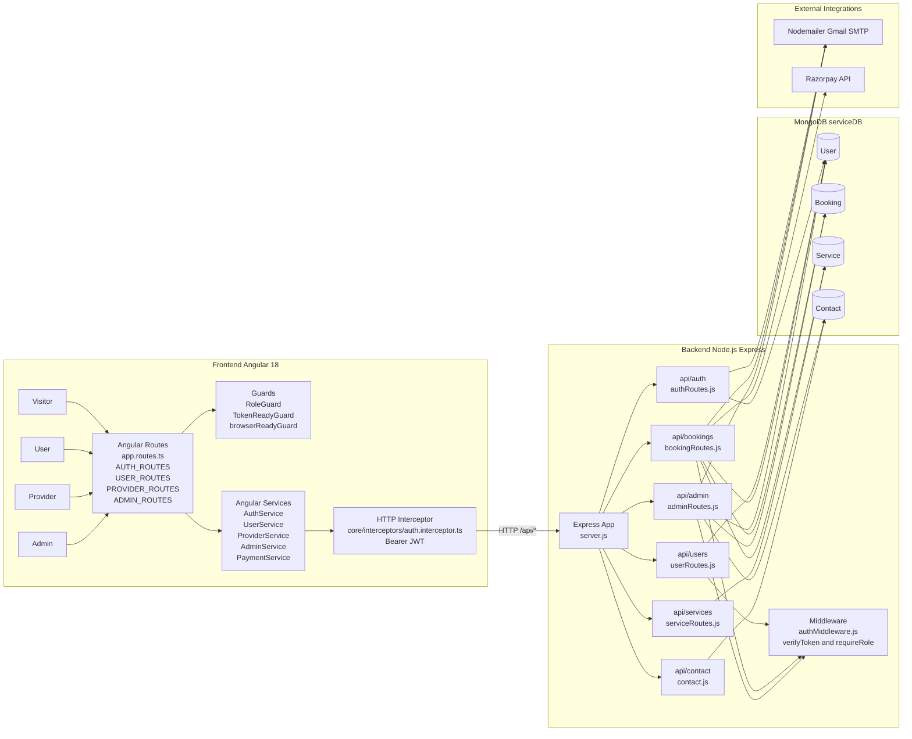
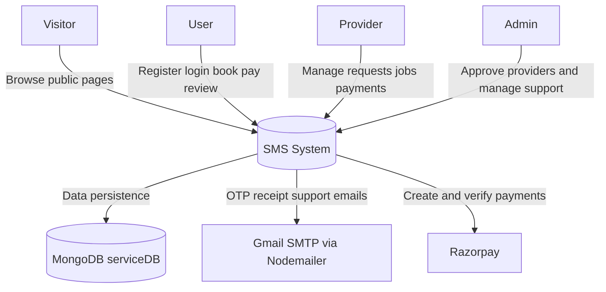
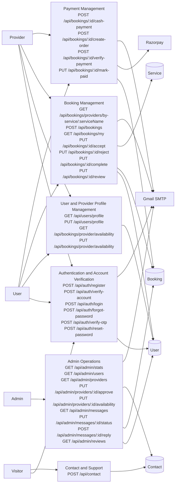
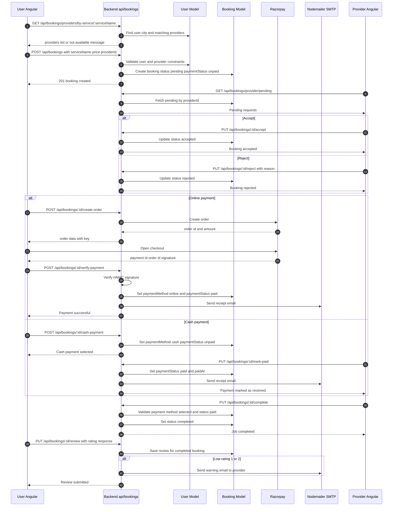
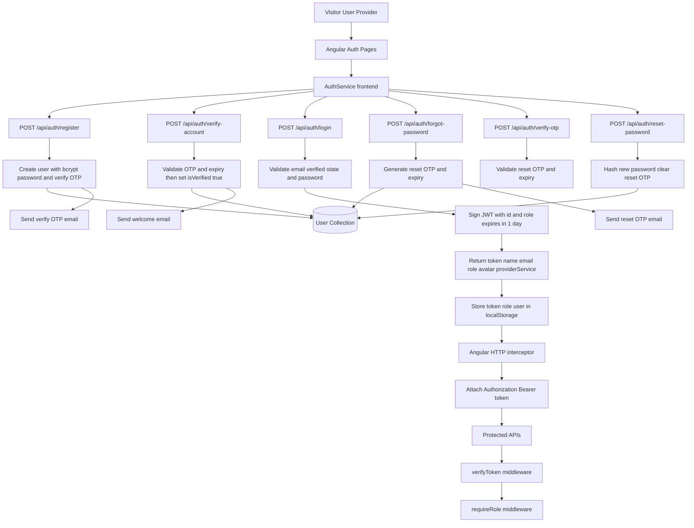
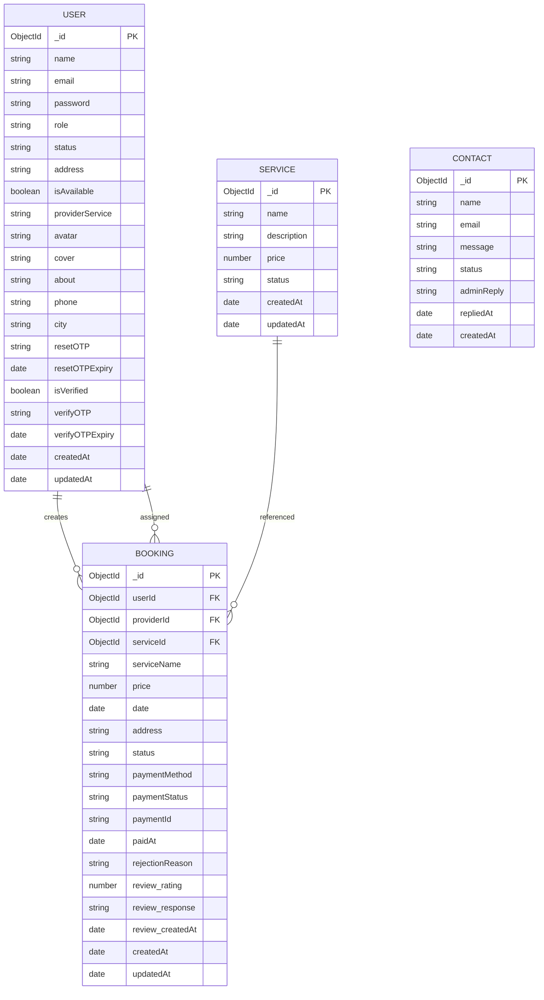

# Service Management System (SMS) - System Diagrams

## 1) System Architecture Diagram

## 2) Level 0 DFD

## 3) Level 1 DFD

## 4) Booking Flow Sequence Diagram

## 5) Authentication Flow Diagram

## 6) Database ER Diagram

